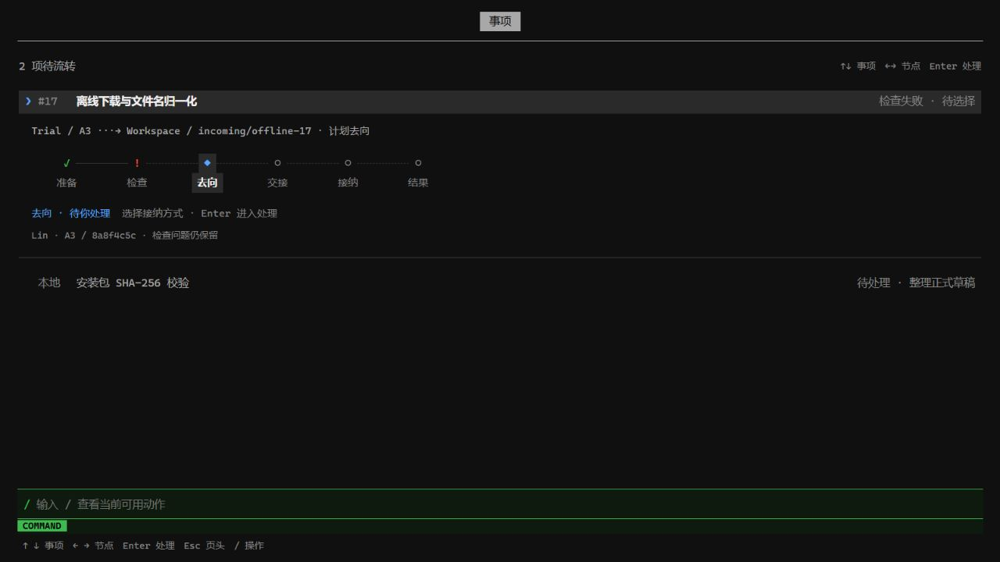
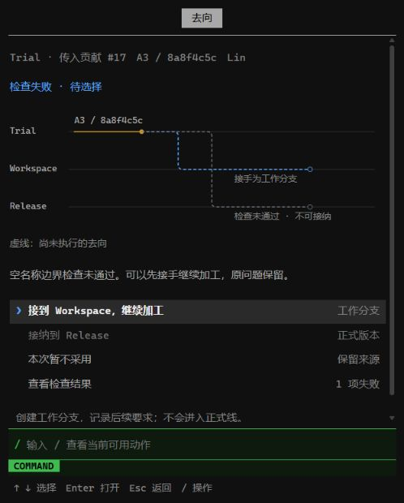

# Gitgo /publish 开发交接参考

2026-10-25。此包随 /publish 实施 Issue 交接，包含需求、设计建议和可运行的 HTML 示例。

**HTML 仅供负责人理解业务与探索交互。具体页面组织、样式、快捷键和交互由负责人自行设计，不要求逐像素复刻，也不要求采用示例的状态机、数据库或 HTTP 服务。最终交付在 Gitgo 正式终端内，延续现有前端语言，并满足真实后端闭环与验收要求。**

阅读顺序：

1. [需求与验收](REQUIREMENTS.md)：要解决什么、前后端各要设计什么、完整范围和交付判定。
2. [具体设计建议](DESIGN-REFERENCE.md)：结构职责、内部 API、状态与恢复、前端组织的参考方案；建议与必须满足的业务约束分开。
3. [HTML 入口](demo/index.html)、[前端逻辑](demo/app.js)、[演示后端](demo/service.py)：以“事项列表 → 选中后展开小流程 → 进入节点处理”展示两条真实 Git 路径。
4. [来源清单](SOURCE-PROVENANCE.json)：示例使用的公开 Gitgo 纯函数快照及基线。



## 运行 HTML 参考

需要 Python 3.11+、Git 2.38+（含 `merge-tree --write-tree`）；无需 pip/npm 安装、GitHub 账户或 Gitgo 的本地配置。下载本分支 ZIP 后进入 `examples/publish-reference/demo`，Windows 双击 `start.bat`，其他平台运行：

```sh
python3 -B service.py --port 8767 --open
```

打开 `http://127.0.0.1:8767/`。端口占用时换成 `--port 8768`。**不要单独双击 index.html：它需要同包服务提供状态和真实操作。** 切勿把服务开放到公网；它仅绑定回环地址，是开发夹具，没有生产认证。

包内带齐引用的源码片段，独立于 Gitgo checkout；旧版演示目录和开发者机器上的绝对路径均不是依赖。运行时新建 `demo/runtime/` 下的隔离 Git 仓库与 SQLite，不读取项目 `.gitgo`、个人凭据或真实工作分支。测试数据写入 `demo/qa-runtime/`。这些目录不属于分发包。

## 体验路径

- Enter 从页头进入事项；上下选事项，左右选小流程节点，Enter 进入节点，Esc 返回。只有选中事项展开小流程。
- 传入 A3：继续准备/检查，实际测试失败；选择接手 Workspace，填写要求并执行，实际创建工作分支。Formal 未改变，失败与待完善要求保留。
- 本地产出 B2：准备/检查通过后编辑正式草稿，执行实际组合预演、组合检查和 Formal 引用写入；可以再推送到**本地夹具远端**。
- `/plan` 调整后续自动/手动推进和去向；`/pause`、`/continue` 控制执行。浏览页面不启动后台操作，离开页面不取消任务。
- `/checks` 可接收固定示例的 A4 修订并重新检查；`/diff`、`/changes`、`/discussion`、`/history` 查看相应内容；`/settings` 调整提交格式、隐私和远端。文字经底部输入。
- `/reset` 建立一组新示例并保留原夹具；不会清理真实仓库。



## 真实性与明确限制

真实执行：隔离 Git 对象/refs、三仓 fetch、工作分支建立、合并树预演、单元测试、正式提交、条件 ref 写入、SQLite 状态、向本地 bare 仓推送。

未接入：真实主/子 Agent、生产权限系统、外部 Issue/评论、共享元数据权威、多用户并发、完整分支清理和包分发。示例讨论仅本地保存，不冒充共享评论；没有虚构模型回复。旧夹具中保留的 provider 示例是契约模拟，当前服务没有暴露旧 UI。

原型固定三个物理仓、示例角色和 `master`，只实现部分集成方法；这些都是夹具简化，**不能成为正式产品假设**。图使用 SVG，不能据此宣称 Bun/Node 或正式终端已支持同样的图形输出。原型 SQLite + Git 不构成跨系统原子事务，未知结果恢复需按正式系统补齐。

`_fixture/source-snapshot` 是公开源码的纯函数输入，经 AST 适配隔离产品导入。此方法只为独立运行示例，正式实现应使用现有应用/工具调用契约，不复制 AST 装载机制。

## 验证与交接

```sh
cd demo
python3 -B -m unittest test_flow -v
```

四个集成用例覆盖：本地正式接纳和 push、失败候选接手但不能正式接纳、暂停/修订/重复请求、目标漂移和草稿保留，以及流程投影对应实际结果。导出后的参考包已独立重跑；截图来自本版 HTML 的键盘联调。**这些不替代正式 Dashboard 的终端验收。**

原型核对的 Gitgo 源码基线：`c8e7906e6ed5e23af29ebdbc51e4bfafe696926b`；发布交接时远端 master：`03a573c396ce65676b07c7ca142dbfdfae65a583`。负责人开工时重新核对当前主线差异。此分支仅承载参考资料，最终功能通过独立 PR 交付，不把示例服务并入产品运行链。
